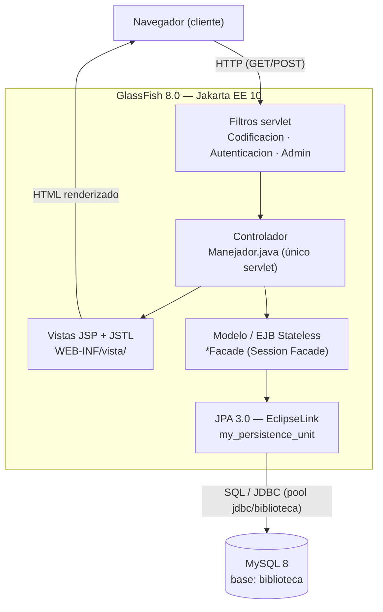
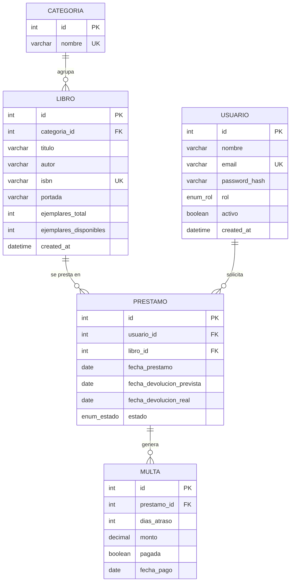
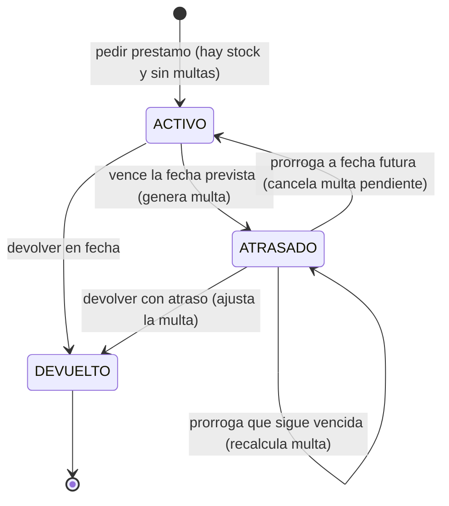

# Informe técnico-académico

## Sistema de Biblioteca — Gestión de préstamos de libros

| Campo | Valor |
|-------|-------|
| **Asignatura / materia** | *(completar)* |
| **Autor/es** | *(completar)* |
| **Docente** | *(completar)* |
| **Fecha de entrega** | 10 de noviembre de 2026 |
| **Versión del proyecto** | 1.0-SNAPSHOT |
| **Repositorio / ruta** | `~/NetBeansProjects/biblioteca` |

---

## Índice

1. [Introducción](#1-introducción)
2. [Objetivos](#2-objetivos)
3. [Marco teórico](#3-marco-teórico)
4. [Análisis y diseño](#4-análisis-y-diseño)
5. [Implementación](#5-implementación)
6. [Pruebas y estado actual](#6-pruebas-y-estado-actual)
7. [Discusión y trabajo futuro](#7-discusión-y-trabajo-futuro)
8. [Conclusiones](#8-conclusiones)
9. [Anexos](#9-anexos)
10. [Bibliografía](#10-bibliografía)

---

## 1. Introducción

El presente informe documenta el diseño, la implementación y el estado final de
un **sistema de gestión de biblioteca**: una aplicación web que administra el
catálogo de libros de una biblioteca y, fundamentalmente, el **ciclo de vida de
los préstamos**: solicitud, devolución, control de stock de ejemplares y
generación de multas por atraso.

El sistema se desarrolló como aplicación web **Jakarta EE 10** desplegada sobre
un servidor de aplicaciones **GlassFish 8.0**, con base de datos **MySQL 8** y
build **Maven**. La interfaz está construida con **JSP + JSTL** siguiendo el
patrón **MVC** (Modelo-Vista-Controlador).

Dos actores interactúan con el sistema:

- **Cliente**: consulta el catálogo público, se registra, solicita libros en
  préstamo, consulta sus préstamos y multas, y paga las multas pendientes.
- **Administrador**: gestiona categorías, libros, usuarios, préstamos,
  devoluciones (con cálculo automático de multas) y el pago de multas.

### Métricas del proyecto

| Métrica | Valor |
|---------|-------|
| Archivos fuente Java | 19 |
| Líneas de código Java | 2.414 |
| Vistas JSP / JSPF | 16 + 2 fragmentos |
| Líneas CSS | 522 |
| Líneas totales en `src/` | 4.623 |
| Tablas en MySQL | 5 |
| Rutas (URL patterns) | 34 |
| Dependencias Maven de negocio | 2 (`jakarta.jakartaee-api` *provided*, `jbcrypt`) |

---

## 2. Objetivos

### 2.1 Objetivo general

Desarrollar una aplicación web que permita gestionar de manera integral los
préstamos de libros de una biblioteca, garantizando la consistencia del stock
de ejemplares y el correcto cobro de multas por devolución tardía.

### 2.2 Objetivos específicos

1. Implementar la arquitectura **MVC** separando vista, control y lógica de
   negocio, de modo que ninguna regla esté embebida en los JSP ni en el servlet.
2. Modelar la base de datos con **5 entidades** relacionadas (categorías,
   libros, usuarios, préstamos, multas) e integridad referencial.
3. Centralizar **todas** las reglas de negocio en EJB *Stateless* (*Session
   Facade*), apoyados en transacciones gestionadas por el contenedor (JTA).
4. Implementar un sistema de **autenticación y autorización** real: login
   contra la base de datos con contraseñas hasheadas (BCrypt) y control de
   acceso por rol mediante filtros servlet.
5. Aplicar **validación de datos** en el servidor (email, ISBN, stock,
   campos obligatorios) y manejar las violaciones de reglas de negocio como
   excepciones de aplicación.
6. Construir una interfaz **responsive** sin frameworks de estilos, con una
   hoja de estilos única basada en variables CSS y *mobile-first*.

---

## 3. Marco teórico

### 3.1 Patrón MVC

El patrón **Modelo-Vista-Controlador** separa la aplicación en tres capas:

- **Modelo**: las entidades JPA (`Libro`, `Usuario`, `Prestamo`, …) y los EJB
  que encapsulan la lógica de negocio y el acceso a datos.
- **Vista**: páginas **JSP** que solo presentan información, usando etiquetas
  **JSTL** (`c:forEach`, `c:if`, `fmt:`); no contienen *scriptlets* ni lógica.
- **Controlador**: un **servlet** que interpreta la URL, invoca al modelo y
  decide qué vista se renderiza.

Esta separación facilita el mantenimiento: cambiar una regla de negocio o una
pantalla no obliga a tocar las demás.

### 3.2 Jakarta EE 10 y sus servicios

| Servicio | Uso en el proyecto |
|----------|--------------------|
| **Servlets / Filtros** | Controlador único (`Manejador`) y 3 filtros de cross-cutting |
| **EJB *Stateless*** | *Session Facades* con transacciones JTA automáticas |
| **JPA 3.0 (EclipseLink)** | Mapeo objeto-relacional y consultas JPQL |
| **CDI** | `beans.xml` con `bean-discovery-mode=all` |
| **JSP + JSTL** | Renderizado de vistas (`jakarta.tags.core`, provisto por GlassFish) |
| **HttpSession** | Mantenimiento del usuario autenticado |

### 3.3 *Session Facade*

Cada dominio del negocio tiene una fachada EJB (`LibroFacade`,
`PrestamoFacade`, …) que hereda de un `AbstractFacade<T>` con el CRUD
genérico. Ventajas:

- El contenedor **gestiona las transacciones** (JTA): si una operación falla,
  se revierte todo (por ejemplo, un préstamo que descuenta stock).
- El controlador queda libre de SQL/JPQL.
- Las reglas de negocio viven en un único lugar auditables y testeables.

### 3.4 BCrypt

Las contraseñas **nunca** se guardan en claro: se almacena su *hash* con
BCrypt (`$2a$10$…`), algoritmo con **salt** aleatorio y coste ajustable, por lo
que dos usuarios con la misma contraseña producen hashes distintos y un volcado
de la tabla no revela credenciales.

### 3.5 Filtros servlet

Los filtros interceptan la cadena de petición-respuesta antes de llegar al
controlador. Aquí se usan para **autorización** (¿tiene sesión? ¿es ADMIN?) y
para **codificación UTF-8** en todas las peticiones, evitando duplicar esa
validación en cada método del servlet.

---

## 4. Análisis y diseño

### 4.1 Arquitectura general



Flujo de una petición:

1. El navegador envía la petición al servidor.
2. Los **filtros** validan codificación, sesión y rol.
3. El servlet `Manejador` hace un `switch` sobre la ruta (`getServletPath()`).
4. El método correspondiente **valida la entrada** y llama al *facade* EJB.
5. El *facade* aplica las **reglas de negocio** y persiste vía JPA.
6. El controlador hace *forward* a la JSP de `WEB-INF/vista/`.
7. La JSP se renderiza con JSTL y devuelve el HTML.

### 4.2 Modelo de datos (diagrama entidad-relación)



> En MySQL: `enum_rol` = `ENUM('CLIENTE','ADMIN')` y `enum_estado` =
> `ENUM('ACTIVO','DEVUELTO','ATRASADO')`. Los enumerados Java usan
> `EnumType.STRING`, por eso los valores están en **mayúsculas**.

**Restricciones de integridad** (script `src/main/setup/biblioteca.sql`):

- Claves foráneas con `ON DELETE RESTRICT` (no se borra un categoría con libros
  ni un usuario con préstamos) y `ON DELETE CASCADE` en `multas.prestamo_id`.
- `CHECK (ejemplares_disponibles >= 0 AND ejemplares_disponibles <= ejemplares_total)`.
- `UNIQUE` en `categorias.nombre`, `libros.isbn` y `usuarios.email`.
- Índices en las columnas más consultadas: `prestamos.usuario_id`,
  `prestamos.libro_id`, `multas.prestamo_id`.

### 4.3 Diagrama de estados de un préstamo



### 4.4 Estructura de paquetes

```
com.mycompany.biblioteca
├── Categoria, Libro, Usuario, Prestamo, Multa   → Entidades JPA (@Entity)
├── Rol, EstadoPrestamo                          → Enums (EnumType.STRING)
├── Configuracion                                → Constantes del negocio
├── ReglaNegocioException                        → Excepción de aplicación
├── controlador/
│   └── Manejador                                → Único servlet (@WebServlet)
├── filtro/
│   ├── CodificacionFiltro                       → UTF-8 en todo (@WebFilter "/*")
│   ├── AutenticacionFiltro                      → exige sesión
│   └── AdminFiltro                              → exige sesión + rol ADMIN
└── sesiones/
    ├── AbstractFacade<T>                        → CRUD genérico
    ├── CategoriaFacade, LibroFacade, UsuarioFacade
    ├── PrestamoFacade                           → reglas de préstamos/multas
    └── MultaFacade
```

---

## 5. Implementación

### 5.1 Stack tecnológico

| Capa | Tecnología | Versión |
|------|------------|---------|
| Vistas | JSP + JSTL | Jakarta EE 10 |
| Controlador | Servlet + Filtros | Jakarta Servlet 6.0 |
| Lógica de negocio | EJB *Stateless* | Jakarta EJB 4.0 |
| Persistencia | JPA / EclipseLink | 3.0 |
| Base de datos | MySQL | 8 |
| Servidor de aplicaciones | Eclipse GlassFish | 8.0.0 |
| Build | Maven (WAR) | 3.8+ |
| JDK de compilación | Java (`source`/`target`) | 11 (runtime: JDK 21) |
| IDE | Apache NetBeans | 31 / 17+ |

### 5.2 Controlador: un único servlet con enrutamiento

`Manejador.java` (727 líneas) es el **único** servlet de la aplicación. Expone
34 rutas con `@WebServlet(urlPatterns = {...})` y las deriva con un `switch`
sobre `getServletPath()`:

```java
switch (ruta) {
    case "/login":          url = login(req, resp);           break;
    case "/catalogo":       url = catalogo(req, resp);        break;
    case "/prestamo/pedir": url = pedirPrestamo(req, resp);   break;
    // ...
    default: resp.sendError(HttpServletResponse.SC_NOT_FOUND); return;
}
```

Convención adoptada: **redirect-after-POST**. Las operaciones de guardado y
eliminación solo aceptan `POST` y, al finalizar, redirigen al listado
(`response.sendRedirect`), lo que evita el reenvío del formulario al recargar
con F5. El servlet **no contiene SQL ni JPQL**: solo valida y delega en los
*facades*.

### 5.3 Reglas de negocio

Todas están implementadas en los EJB y parametrizadas en la clase
`Configuracion`:

| Regla | Constante | Implementación |
|-------|-----------|----------------|
| Un préstamo dura 7 días | `DIAS_PRESTAMO = 7` | `fecha_devolucion_prevista = hoy + 7` |
| Multa por día de atraso | `MONTO_MULTA_DIARIO = 1.50` | `monto = días_atraso × 1.50` |
| Solo se presta si hay stock | — | `ejemplaresDisponibles <= 0` ⇒ excepción |
| Pedir descuenta 1 ejemplar | — | `max(0, disponibles − 1)` |
| Devolver devuelve 1 ejemplar | — | `min(total, disponibles + 1)` |
| Cliente con multas impagas no puede pedir | — | `COUNT(multa WHERE pagada=false) > 0` ⇒ excepción |
| Préstamo vencido ⇒ `ATRASADO` | — | `actualizarAtrasados()` antes de cada listado |
| Atraso ⇒ multa automática | `MONTO_MULTA_DIARIO = 1.50` | se genera al detectar el vencimiento (sin esperar la devolución) y se ajusta al devolver |
| Nunca se cobra dos veces los mismos días | — | `dias_debidos = días_totales − días_ya_pagados` |
| Prórroga que deja sin atraso ⇒ cancela la multa pendiente | — | se eliminan las multas no pagadas del préstamo |
| Prórroga (admin) | — | nueva fecha nunca anterior a la fecha del préstamo |
| Cuenta desactivada no presta | — | `usuario.isActivo() == false` ⇒ excepción |
| No eliminar categoría con libros / libro con préstamos | — | verificación previa + `ON DELETE RESTRICT` |
| Contraseña mínima 6 caracteres | `PASSWORD_MINIMO = 6` | hash BCrypt |
| Email válido y único | `PATRON_EMAIL` | expresión regular + `UNIQUE` |
| ISBN-10 o ISBN-13, único | `PATRON_ISBN` | expresión regular + `UNIQUE` |
| Longitud máxima de los campos | `NOMBRE_MAXIMO`, `EMAIL_MAXIMO`, `TITULO_MAXIMO`, `AUTOR_MAXIMO`, `ISBN_MAXIMO` | verificación en el facade antes de `create`/`edit` |

Las violaciones se informan con `ReglaNegocioException`, marcada como
`@ApplicationException(rollback = true)`, de modo que **el contenedor revierte
la transacción** y el mensaje se muestra en el formulario o en `error.jsp`.

#### 5.4 Validación en tres capas de los formularios (CRUD)

| Capa | Dónde | Qué valida |
|------|-------|------------|
| **A · Cliente** | Atributos HTML5 en los JSP | `required`, `minlength`, `maxlength`, `pattern` (ISBN-10/13), `min` en la fecha de prórroga y `title` con el mensaje que muestra el navegador |
| **B · Servidor** | `Manejador` | `parametroEntero()` devuelve `null` si el valor no es numérico (sin excepción); `ejemplaresTotal` no numérico devuelve el formulario con `error`; falta de `id` ⇒ **400**, `id` inexistente ⇒ **404**; fecha de prórroga inválida ⇒ mensaje en el formulario |
| **C · Negocio** | `Configuracion` + facades | Longitudes máximas (`NOMBRE_MAXIMO` 100, `EMAIL_MAXIMO` 150, `TITULO_MAXIMO` 200, `AUTOR_MAXIMO` 150, `ISBN_MAXIMO` 13), email/ISBN por regex y campos obligatorios |

La capa A es solo comodidad (se puede saltar con `curl`): la que **garantiza**
la integridad es la C, porque evita el error 500 que produciría exceder el
tamaño de la columna en MySQL; la B evita perder el formulario ante un
parámetro mal formado.

#### 5.5 Paginación

| Caso de uso | Lista de registros|
|------------|-----------------|
| Catálogo público (/catalogo) | 10 por página, filtro q y categoría|
| Listado de libros (admin) | 10 por página, ordenado por título|
| Listado de categorías (admin) | 10 por página, ordenado alfabéticamente|
| Listado de usuarios (admin) | 10 por página, ordenado alfabéticamente|
| Listado de préstamos (admin) | 10 por página, con conteo de atrasados|
| "Mis préstamos" (cliente) | 10 por página, préstamos y multas separadas|
| Listado de multas (admin) | 10 por página, suma total a cobrar|

| Mecanismo | Detalle |
|-----------|---------|
| **Fragmento único** | `WEB-INF/vista/paginacion.jspf`, incluido **una sola vez por lista**, dentro del bloque de resultados |
| **Tamaño de página** | `Configuracion.PAGINA_TAMANO = 10` registros |
| **Navegación** | «‹ Anterior · 1 2 … · Siguiente ›» + «Mostrando 1–10 de N»; si solo hay una página no se dibuja |
| **Filtros conservados** | `Pagina` guarda `rutaPagina` + `parametros`, así que pasar de página respeta `q` y `categoria` (`/libro/listar?pagina=2&categoria=1`) |
| **Dos listas en una vista** | En `mis-prestamos.jsp` se hace `<c:set var="pagina" value="${paginaPrestamos\|paginaMultas}"/>` antes de incluir el fragmento |

#### 5.6 Búsqueda (con búsqueda en vivo)

| Pantalla | Fragmento | Parámetros | Busca por |
|---|---|---|---|
| `/catalogo` (público) | `buscador-libros.jspf` | `q`, `categoria` | título o autor + categoría |
| `/libro/listar` (ADMIN) | `buscador-libros.jspf` (reutilizado) | `q`, `categoria` | título o autor + categoría |
| `/prestamo/listar` (ADMIN) | formulario propio | `q` | nombre o email de la persona, o título del libro |

- **Fragmento reutilizable** `buscador-libros.jspf`: la vista fija el destino
  con `<c:set var="accionBuscador" …/>` antes de incluirlo (por defecto
  `/catalogo`), de modo que el mismo formulario se usa en el catálogo público
  y en el listado de libros del administrador.
- **Consulta en los facades**: `LibroFacade.buscar/contarBuscar` y
  `PrestamoFacade.buscar/contarBuscar`, con JPQL `LOWER(...) LIKE :t`
  siempre paginado; sin texto devuelven todo (mismo camino que `pagina()`).
- **Búsqueda en vivo** (`js/buscador.js`): debounce de 300 ms + `fetch` +
  `DOMParser`. Pide la misma URL y reemplaza **solo** los bloques
  `data-busqueda="resumen|contador|resultados"`, de modo que el formulario no
  se toca y el foco se conserva. El contador se renderiza siempre (oculto con
  `hidden` cuando no hay filtro) para poder aparecer y desaparecer en ambos
  sentidos. Usa `AbortController` para cancelar el pedido anterior y
  `history.replaceState` para mantener la URL. Sin `fetch`, el formulario
  sigue funcionando con el envío normal.


| Mecanismo | Detalle |
|-----------|---------|
| **Autenticación** | `UsuarioFacade.autenticar(email, password)` compara con `BCrypt.checkpw()` contra la tabla `usuarios`. |
| **Sesión** | El objeto `Usuario` se guarda en `HttpSession`; timeout de 30 min (`web.xml`). |
| **Autorización de cliente** | `AutenticacionFiltro` protege `/mis-prestamos` y `/prestamo/*`. |
| **Autorización de admin** | `AdminFiltro` exige sesión **y** `Rol.ADMIN` en las ramas `/categoria/*`, `/usuario/*`, `/multa/*`, `/libro/*` y `/prestamo/*`. |
| **Vistas ocultas** | Las JSP viven en `WEB-INF/vista/`, inaccesibles por URL directa (404). |
| **Mutaciones por POST** | `*/guardar` y `*/eliminar` solo aceptan `POST` (mitiga CSRF básico y el reenvío accidental). |
| **Codificación** | `CodificacionFiltro` fuerza UTF-8 en petición y respuesta (acentos y ñ). |
| **Sin datos sensibles** | Solo se almacena el hash BCrypt; nunca la contraseña en claro. |

### 5.7 Interfaz de usuario

16 vistas JSP, todas bajo `WEB-INF/vista/`, con fragments reutilizables
(`cabecera.jspf` con menú dinámico según sesión/rol, y `pie.jspf`):

| Pantalla | Archivo | Acceso |
|----------|---------|--------|
| Ingreso / registro | `login.jsp`, `registro.jsp` | público |
| Catálogo con búsqueda y filtro por categoría | `catalogo.jsp` | público |
| Detalle del libro y botón "Pedir" | `libro-detalle.jsp` | público |
| Mis préstamos y multas | `mis-prestamos.jsp` | sesión |
| ABM de categorías | `categoria-listar.jsp`, `categoria-form.jsp` | ADMIN |
| ABM de libros | `libro-listar.jsp`, `libro-form.jsp` | ADMIN |
| ABM de usuarios | `usuario-listar.jsp`, `usuario-form.jsp` | ADMIN |
| Préstamos, prórroga y devolución | `prestamo-listar.jsp`, `prestamo-form.jsp` | ADMIN |
| Multas pendientes y pago | `multa-listar.jsp` | ADMIN |
| Errores de negocio | `error.jsp` | — |

El diseño está en una única hoja `css/style.css` (≈1400 líneas) con **variables
CSS**, *mobile-first* (Grid/Flexbox + *media queries*), modo oscuro por
`prefers-color-scheme` y **sin colores hardcodeados** dentro de los JSP, lo que
permite retematizar la aplicación editando un solo archivo. Los fragments
reutilizables son `cabecera.jspf`, `pie.jspf`, `paginacion.jspf` y
`buscador-libros.jspf`; la lógica de la búsqueda en vivo vive en
`js/buscador.js` (sin scriptlets).

### 5.8 Persistencia y configuración

- **Unidad de persistencia** `my_persistence_unit`, transacción **JTA**
  (gestionada por el contenedor), con DataSource JNDI `jdbc/biblioteca`.
- **`eclipseLink.ddl-generation=none`**: el esquema lo define
  `src/main/setup/biblioteca.sql` (script **idempotente**, que además migra columnas
  faltantes sin borrar datos).
- **`eclipseLink.cache.shared.default=false`**: sin caché compartida; cada
  lectura va a la base, de modo que los ejemplares disponibles **nunca quedan
  desfasados** entre usuarios concurrentes.
- **Pool JDBC** `bibliotecaPool` → recurso `jdbc/biblioteca` creado en
  GlassFish con `asadmin`; el driver `mysql-connector-j-8.4.0.jar` está en
  `glassfish/domains/domain1/lib/`.

---

## 6. Pruebas y estado actual

### 6.1 Estado

El proyecto compila (`mvn clean package` → `target/biblioteca-1.0-SNAPSHOT.war`)
y está desplegado en GlassFish sobre
**<http://localhost:8080/biblioteca/>**.

### 6.2 Pruebas funcionales (manuales)

| # | Caso | Resultado esperado | Resultado |
|---|------|--------------------|-----------|
| 1 | Login con credenciales válidas | Inicia sesión y redirige al catálogo | OK |
| 2 | Login con contraseña incorrecta | Mensaje de error, sin sesión | OK |
| 3 | Registro de cliente nuevo | Alta con hash BCrypt, email único | OK |
| 4 | Pedir libro con stock | Crea préstamo ACTIVO, descuenta 1 ejemplar | OK |
| 5 | Pedir libro sin stock | `ReglaNegocioException`, sin descuento | OK |
| 6 | Pedir con multa impaga | Bloqueo hasta pagar | OK |
| 7 | Devolver en fecha | Estado DEVUELTO, sin multa, repone stock | OK |
| 8 | Devolver con atraso | Multa = días × 1.50, préstamo DEVUELTO | OK |
| 9 | Cliente intenta acceder a `/libro/listar` | Redirige a `/login` (AdminFiltro) | OK |
| 10 | Sin sesión en `/mis-prestamos` | Redirige a `/login` | OK |
| 11 | Eliminar categoría con libros | Se rechaza con mensaje | OK |
| 12 | Volver a cargar el script SQL | No duplica ni borra datos | OK |

### 6.3 Credenciales de prueba

| Rol | Email | Contraseña |
|-----|-------|------------|
| Administrador | `admin@biblioteca.com` | `admin123` |
| Cliente | `cliente@biblioteca.com` | `cliente123` |

### 6.4 Incidente detectado durante la puesta en marcha

**Síntoma:** al presionar *Run* en NetBeans el proyecto no se actualizaba y el
log informaba `The module has not been deployed.`

**Causa raíz:** GlassFish tenía una copia anterior de la aplicación
(`applications/biblioteca`, desplegada el 02/11) ocupando el *context root*
`/biblioteca`; la nueva compilación intentaba desplegarse como
`biblioteca-1.0-SNAPSHOT` en el mismo contexto y el servidor la rechazaba:

```
Virtual server server already has a web module biblioteca loaded at /biblioteca,
therefore web module biblioteca-1.0-SNAPSHOT cannot be loaded at this context path
```

**Solución:** eliminar el despliegue huérfano desde
*Servicios → Servidores → GlassFish → Aplicaciones desplegadas → Undeploy* y
volver a ejecutar *Run*. Lección aprendida: un despliegue previo puede quedar
huérfano y bloquear los posteriores.

---

## 7. Discusión y trabajo futuro

### 7.1 Fortalezas

- **Separación de capas estricta**: ningún JSP tiene lógica de negocio; ningún
  *facade* conoce HTTP; el servlet no toca la base de datos.
- **Integridad garantizada**: reglas de negocio + restricciones SQL + rollback
  automático por JTA.
- **Seguridad razonable** para el alcance: BCrypt, autorización por rol en
  filtros, vistas protegidas y mutaciones por POST.
- **Despliegue reproducible**: script SQL idempotente y configuración
  documentada en `README.md`.

### 7.2 Limitaciones

- No hay **tests automatizados** (JUnit) sobre las reglas de negocio.
- La búsqueda en vivo depende de JavaScript; sin él, el formulario sigue
  funcionando pero con recarga completa de la página.
- El campo `portada` acepta **URL o archivo subido** (`multipart/form-data`) y
  las vistas lo muestran, pero las imágenes subidas **se pierden al redeploy**
  (viven en `applications/biblioteca/img/portadas/`).
- No existe recuperación de contraseña por email ni perfil de usuario.
- No hay *auditoría* de quién registró o devolvió cada préstamo.

### 7.3 Trabajo futuro (priorizado)

| Prioridad | Mejora |
|-----------|--------|
| Alta | Copiar las portadas subidas a `src/main/webapp/img/portadas/` para que sobrevivan al redeploy. |
| Alta | Tests unitarios (JUnit) de `PrestamoFacade` y `UsuarioFacade`. |
| Alta | Perfil del cliente: cambiar contraseña y editar sus datos. |
| Media | Búsqueda por ISBN y ordenación (asc/desc) en los listados. |
| Media | Reportes: préstamos por período, libros más prestados, multas cobradas/pendientes. |
| Media | Historial de multas pagadas y recuperación de contraseña. |
| Baja | `@Schedule` (TimerService) para avisos de vencimiento. |
| Baja | Exportación a CSV/PDF, Docker Compose, cola de espera, *dark mode*. |

---

## 8. Conclusiones

1. Se construyó una aplicación web funcional que cubre el ciclo completo de
   préstamo de una biblioteca, desde la consulta pública del catálogo hasta la
   liquidación de multas, con dos roles claramente diferenciados.
2. El uso del patrón **MVC** con un único controlador y *Session Facades*
   permitió mantener la lógica de negocio concentrada, testeable y ajena tanto
   a la interfaz como al transporte HTTP.
3. La **integridad de los datos** se logra en tres frentes complementarios:
   restricciones en MySQL, validación en el servidor y transacciones JTA con
   *rollback* automático ante excepciones de negocio.
4. El modelo de seguridad (BCrypt + filtros por rol + vistas en `WEB-INF`)
   satisface los requisitos de un sistema académico y sienta las bases para
   incorporar más adelante protección CSRF y recuperación de contraseña.
5. El incidente del despliegue duplicado evidenció la importancia de revisar
   el estado del servidor de aplicaciones ante fallos silenciosos de
   despliegue, experiencia documentada en la sección 6.4.

---

## 9. Anexos

### Anexo A — Rutas principales

| Método | Ruta | Acceso | Descripción |
|--------|------|--------|-------------|
| GET/POST | `/login` | público | Iniciar sesión |
| GET | `/logout` | cualquiera | Cerrar sesión |
| GET/POST | `/registro` | público | Alta de cliente |
| GET | `/catalogo` | público | Catálogo con búsqueda y filtro |
| GET | `/libro/detalle?id=` | público | Detalle de un libro |
| GET | `/Categoria?codigoCat=` | público | Libros de una categoría |
| GET | `/mis-prestamos` | sesión | Préstamos y multas del cliente |
| POST | `/prestamo/pedir` | sesión | Solicitar un libro |
| GET/POST | `/categoria/*` | ADMIN | Módulo categorías |
| GET/POST | `/libro/*` | ADMIN | Módulo libros |
| GET/POST | `/usuario/listar`, `/usuario/editar`, `/usuario/guardar` | ADMIN | Listar y editar usuarios (el alta está en `/registro`; sin borrado) |
| GET/POST | `/prestamo/*` | ADMIN | Módulos préstamos, prórroga y devolución |
| GET/POST | `/multa/*` | ADMIN | Módulo multas |

### Anexo B — Instalación y ejecución

```bash
# 1) Base de datos (script idempotente)
mysql -uUSUARIO -p < src/main/setup/biblioteca.sql

# 2) Driver en el servidor (una sola vez)
cp ~/.m2/repository/com/mysql/mysql-connector-j/8.4.0/mysql-connector-j-8.4.0.jar \
   ~/GlassFish_Server/glassfish/domains/domain1/lib/

# 3) Pool JDBC en GlassFish (si no existe)
asadmin create-jdbc-connection-pool \
  --datasourceclassname com.mysql.cj.jdbc.MysqlDataSource \
  --restype javax.sql.ConnectionPoolDataSource \
  --property serverName=localhost:portNumber=3306:databaseName=biblioteca:\
user=USUARIO:password=CLAVE:useSSL=false bibliotecaPool
asadmin create-jdbc-resource --poolname bibliotecaPool jdbc/biblioteca

# 4) Compilar
mvn clean package

# 5) Ejecutar en NetBeans: F11 (build) y F6 (run)
#    → http://localhost:8080/biblioteca/
```

### Anexo C — Equivalencia de enums

| Enum Java | Valores | Columna MySQL |
|-----------|---------|---------------|
| `Rol` | `CLIENTE`, `ADMIN` | `usuarios.rol ENUM('CLIENTE','ADMIN')` |
| `EstadoPrestamo` | `ACTIVO`, `DEVUELTO`, `ATRASADO` | `prestamos.estado ENUM('ACTIVO','DEVUELTO','ATRASADO')` |

---

## 10. Bibliografía

1. Jakarta EE Working Group. *Jakarta EE 10 — Jakarta Servlet, Jakarta
   Enterprise Edition y Jakarta Persistence*. Eclipse Foundation, 2022.
   <https://jakarta.ee/specifications/>
2. Oracle. *The Java EE Tutorial — Patterns* (patrón MVC y *Session Facade*).
   <https://docs.oracle.com/javaee/7/tutorial/>
3. Bauer, C. & King, G. *Java Persistence with Hibernate*, 2ª ed. Manning,
   2019.
4. Bloch, J. *Effective Java*, 3ª ed. Addison-Wesley, 2018.
5. Probst, N. et al. *BCrypt — A Password Hashing Function*. OpenBSD.
   <https://www.openbsd.org/papers/bcrypt-paper.pdf>
6. Proyecto: `README.md`, `TODO.md` y fuente de
   `~/NetBeansProjects/biblioteca`.

---

*Informe generado el 10 de noviembre de 2026 a partir del código fuente del
proyecto `biblioteca` v1.0-SNAPSHOT.*
